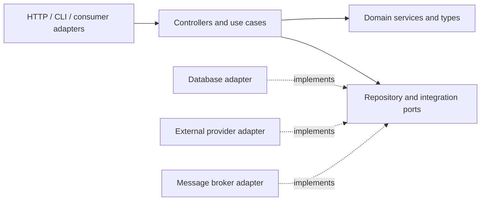
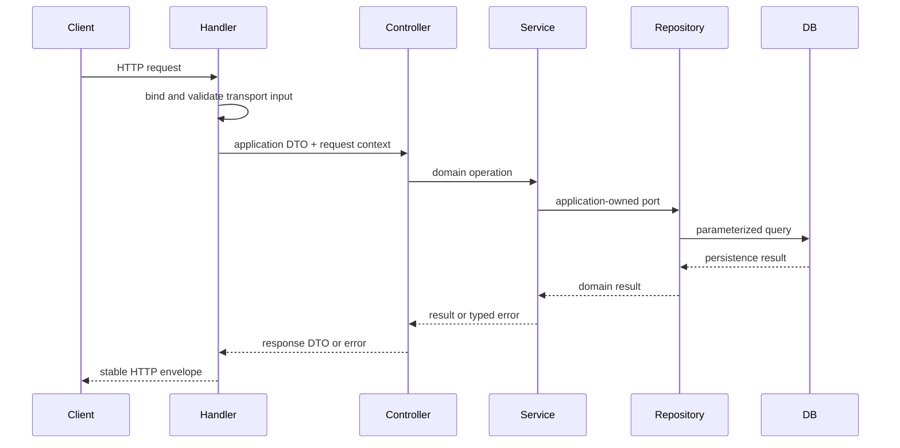

# Go Backend Architecture Guidelines

This document defines the architecture, folder structure, coding conventions, and
extension workflows for a production Go backend. It is deliberately domain-neutral:
replace examples such as `resource`, `workflow`, and `provider` with the language of the
application being built.

The standard preserves a predictable layered style while keeping business code independent
from HTTP frameworks, databases, message brokers, and external vendors.

## Table of contents

1. [Scope and design principles](#1-scope-and-design-principles)
2. [Dependency model](#2-dependency-model)
3. [Canonical project structure](#3-canonical-project-structure)
4. [Runtime and bootstrap](#4-runtime-and-bootstrap)
5. [Request architecture](#5-request-architecture)
6. [Dependency injection](#6-dependency-injection)
7. [Provider and integration adapters](#7-provider-and-integration-adapters)
8. [Persistence and transactions](#8-persistence-and-transactions)
9. [Caching](#9-caching)
10. [Messaging and background work](#10-messaging-and-background-work)
11. [Configuration and security](#11-configuration-and-security)
12. [Observability and operations](#12-observability-and-operations)
13. [Testing](#13-testing)
14. [Coding conventions](#14-coding-conventions)
15. [Delivery and deployment](#15-delivery-and-deployment)
16. [Extension recipes](#16-extension-recipes)
17. [Review checklists](#17-review-checklists)
18. [Guardrails and exceptions](#18-guardrails-and-exceptions)

## 1. Scope and design principles

This guide prescribes:

- Package ownership and dependency direction.
- The responsibilities of transport, application, domain, persistence, and integration code.
- Explicit construction and wiring of dependencies.
- Patterns for HTTP, consumers, scheduled jobs, and utilities.
- Testing, observability, security, and delivery expectations.

It does not prescribe the application's entities, API resources, database schema, cloud,
or external providers. Gin, GORM with PostgreSQL, Redis, Kafka, Cobra, Viper, and Zap are useful
defaults, not dependencies that business rules may assume.

### Core principles

| Principle              | Rule                                                                                                                                 |
| ---------------------- | ------------------------------------------------------------------------------------------------------------------------------------ |
| Predictable layers     | HTTP requests follow handler -> controller/use case -> service -> repository.                                                        |
| Inward dependencies    | Outer adapters depend on application-owned contracts; domain code never imports transport or vendor packages.                        |
| Explicit composition   | Constructors and composition roots wire dependencies. Avoid hidden global initialization.                                            |
| Narrow contracts       | Introduce interfaces at behavior boundaries that need substitution, isolation, or multiple implementations.                          |
| One binary, many modes | When modes share a domain and release lifecycle, compile once and select HTTP, consumer, cron, or utility behavior with subcommands. |
| Context everywhere     | Cancellation, deadlines, tracing, and request metadata propagate through `context.Context`.                                          |
| Observable by default  | Logs, metrics, traces, health checks, and correlation IDs are part of the runtime design.                                            |
| Secure by default      | Validate at boundaries, minimize data access, redact sensitive data, and never place secrets in source or logs.                      |

Do not force one binary across independently owned applications with different release,
scaling, or security requirements. Shared source in a monorepo does not require shared
deployment.

## 2. Dependency model

Dependencies point from delivery and infrastructure toward application-owned behavior.



Allowed dependencies:

- Handlers may import Gin, request/response DTOs, error mapping, and controllers.
- Controllers/use cases may import domain services, application DTOs, and application ports.
- Services may import domain models, value objects, and narrow repository/integration ports.
- Repository implementations may import GORM, SQL drivers, persistence models, and domain types.
- Provider adapters may import vendor SDKs and provider-specific wire DTOs.
- Composition roots may import all concrete implementations required to wire a runtime.

Forbidden dependencies:

- Services or repositories importing Gin types.
- Domain packages importing GORM, Kafka, Redis, Viper, or vendor SDKs.
- Core workflows branching on a vendor name or provider-specific response type.
- Repositories calling HTTP endpoints or implementing business policy.
- Handlers opening transactions or executing database queries.

An interface belongs to the package that consumes the behavior, not automatically to the
package that implements it. Do not create an interface merely to mirror every concrete
type. A concrete implementation is appropriate when there is no meaningful boundary.

## 3. Canonical project structure

```text
.
|-- main.go
|-- go.mod
|-- cmd/                         # Cobra commands and runtime selection
|-- server/                      # HTTP engine, route groups, server lifecycle
|-- middleware/                  # Global transport middleware
|-- config/                      # Typed configuration schema and validation
|-- envs/                        # Optional local environment files; no real secrets
|-- internal/
|   |-- apps/
|   |   `-- <app>/
|   |       |-- handler/         # HTTP adapters
|   |       |-- controller/      # Input orchestration / application use cases
|   |       |-- services/        # Business rules and transaction ownership
|   |       |-- repositories/    # Persistence ports and implementations
|   |       |-- models/          # Domain and persistence models, separated as needed
|   |       |-- dtos/            # Application and API data transfer objects
|   |       |-- interfaces/      # Cross-cutting application-owned contracts
|   |       |-- provider/        # Provider factory or registry
|   |       |-- adapters/        # External provider implementations
|   |       |-- cache/           # App-specific cache policy
|   |       |-- constant/        # Stable enums and keys, used sparingly
|   |       `-- container.go     # App-level dependency declarations
|   `-- platform/
|       |-- datastore/           # SQL and migration infrastructure
|       |-- redis/               # Distributed cache adapter
|       |-- kafka/               # Broker producer/consumer adapter
|       |-- network/             # Outbound HTTP client policy
|       |-- logger/              # Structured logging setup
|       `-- telemetry/           # Tracing, metrics, profiling
|-- scripts/
|   |-- consumer/                # Consumer runtime loops
|   |-- cron/                    # Scheduled batch implementations
|   `-- backfill/                # Explicit, restartable data operations
|-- migrations/                  # Ordered, reviewable schema migrations
|-- templates/                   # Email or document templates
|-- tests/                       # Cross-package and end-to-end tests
|-- mocks/                       # Generated mocks only
|-- deploy/                      # Container and orchestration definitions
`-- docs/                        # Architecture, operations, and decisions
```

### Folder rules

- Use `internal/` for code that must not become a public Go API.
- Create only folders the application needs. Empty architectural placeholders add noise.
- Prefer domain-oriented subpackages when a layer becomes large, for example
  `services/booking` and `services/availability`, while preserving dependency direction.
- Put truly reusable technical adapters in `internal/platform`; do not move domain helpers
  there merely because two features call them.
- Keep generated mocks separate and reproducible. Never hand-edit generated files.
- Keep migrations outside repository methods so schema changes are visible and deployable.

## 4. Runtime and bootstrap

`main.go` should only delegate to the command registry and map a final error to an exit code.
Cobra is the recommended default when the binary has multiple modes.

```go
func main() {
    if err := cmd.Execute(); err != nil {
        os.Exit(1)
    }
}
```

Typical modes are:

| Mode             | Lifetime            | Deployment shape       |
| ---------------- | ------------------- | ---------------------- |
| HTTP server      | Long-running        | Deployment or service  |
| Message consumer | Long-running        | Lag-scaled worker      |
| Cron             | Run once and exit   | Scheduled job          |
| Backfill/utility | Run once, resumable | Manually triggered job |

Every command follows the same bootstrap order:

1. Parse and validate typed configuration.
2. Initialize the base logger, tracing, and metrics.
3. Open infrastructure clients with explicit timeouts and connection limits.
4. Construct repository adapters.
5. Construct services and application controllers.
6. Construct the mode-specific server, consumer, or job.
7. Run until completion or cancellation.
8. Stop accepting work, drain in-flight work, flush telemetry, and close resources.

Long-running modes must listen for `SIGINT` and `SIGTERM`. HTTP servers use bounded graceful
shutdown. Consumers stop fetching, finish or abandon work according to broker semantics,
and commit only completed messages. Run-once commands return errors instead of terminating
deep inside the call stack.

## 5. Request architecture



### Handler

The handler is a transport adapter. It binds path, query, header, and body values; performs
transport-level validation; invokes a controller; and maps the outcome to HTTP. It does not
contain business rules or query a database.

### Controller or use case

The controller coordinates one application action. It authorizes the action at the
application level, translates validated DTOs into domain inputs, invokes services, and
shapes the output. A separate `Serializer` method is allowed when it is an established
project convention, but binding and orchestration must remain independently testable.

### Service

The service implements business behavior, enforces invariants, coordinates repositories or
integrations, and owns transaction boundaries. It must be callable from HTTP, consumers,
and jobs without fabricating a Gin context.

### Repository

The repository persists and retrieves data. It translates persistence records to domain
types and hides query construction. It does not decide business eligibility, send messages,
or call external providers.

### Errors

Define errors around application meaning, such as not found, conflict, invalid state,
unauthorized, dependency unavailable, or internal failure. Wrap causes with `%w`. Map errors
to HTTP status codes or retry decisions only at the relevant delivery boundary. Do not use
string comparison to classify errors.

## 6. Dependency injection

Use manual constructor injection. Concrete dependencies are selected in a composition root,
usually a command bootstrap or an app-level container constructor.

```go
type ResourceRepository interface {
    FindByID(ctx context.Context, query Queryer, id uint64) (Resource, error)
}

type ResourceService struct {
    repository ResourceRepository
    transactions TransactionManager
    logger Logger
}

func NewResourceService(
    repository ResourceRepository,
    transactions TransactionManager,
    logger Logger,
) (*ResourceService, error) {
    if repository == nil || transactions == nil || logger == nil {
        return nil, errors.New("resource service dependencies are required")
    }
    return &ResourceService{repository: repository, transactions: transactions, logger: logger}, nil
}
```

Repository and service containers may group application-scoped dependencies, but they are
not general-purpose service locators. Prefer passing the two or three dependencies a
constructor uses over passing the complete container.

Request-scoped state may hold:

- `context.Context`.
- Authenticated principal and tenant information.
- Correlation and trace identifiers.
- A logger enriched with request fields.

It should not expose every service, raw database connection, or vendor client. Services are
application-scoped and safe for concurrent use. Use `sync.Once` only when lazy creation is
materially useful and initialization is thread-safe; eager startup is simpler and exposes
configuration failures earlier.

## 7. Provider and integration adapters

Use this pattern whenever several external systems provide the same capability.

1. Define a stable capability interface using domain-owned inputs and outputs.
2. Put each provider in its own adapter package.
3. Keep provider request/response types inside that package.
4. Translate provider errors into application error categories.
5. Register implementations in one factory or registry at startup.
6. Run the same contract tests against every implementation.

```go
type Provider interface {
    ID() string
    Evaluate(ctx context.Context, request EvaluationRequest) (EvaluationResult, error)
}
```

A `switch` factory is acceptable for a small, static provider set. Prefer a map-based
registry when providers are configured dynamically, decorated, or numerous. Registration
must fail on duplicate IDs. Core workflows ask for the capability by ID and never inspect a
concrete provider type.

Outbound clients must define connect/request timeouts, bounded retries with jitter for safe
operations, response-size limits, trace propagation, and redacted request logging. Retries
must respect context cancellation and operation idempotency.

## 8. Persistence and transactions

GORM with PostgreSQL is a recommended default adapter. The domain does not import GORM.

- Services own transaction boundaries because they know the complete unit of work.
- Repositories accept a narrow query/transaction interface or a transaction-scoped store.
- All values are parameterized; never build SQL from untrusted strings.
- Explicitly select or allow-list dynamic sort columns and table names.
- Translate database-specific errors into application errors.
- Avoid unbounded result sets and accidental N+1 queries.
- Pass context to every query.
- Define pool limits, query timeouts, and slow-query telemetry.

Schema changes use ordered migrations with a documented rollback or forward-fix strategy.
Large backfills are separate, resumable commands and are not hidden inside a startup
migration. Persistence models may differ from domain models and API DTOs; translation is an
intentional boundary.

## 9. Caching

Choose cache behavior from data semantics, not convenience.

| Cache          | Suitable data                                       | Required policy                                          |
| -------------- | --------------------------------------------------- | -------------------------------------------------------- |
| In-memory      | Small, mostly static, instance-local reference data | Thread safety, refresh behavior, memory bound            |
| Distributed    | Shared, expensive, dynamically reused results       | Namespaced key, TTL, invalidation, serialization version |
| Request-scoped | Duplicate reads during one operation                | Request lifetime and no cross-request leakage            |

Redis is the recommended distributed adapter. Every cache use documents:

- Key format and tenant scope.
- TTL and acceptable staleness.
- Cache-aside, write-through, or invalidation behavior.
- Behavior on cache failure.
- Stampede prevention where needed.
- Whether empty and error results may be cached.

Correctness must not depend on a best-effort cache unless the cache is explicitly the system
of record. Never place secrets or unencrypted sensitive payloads in cache keys.

## 10. Messaging and background work

Kafka is the recommended event-stream adapter. Define application-owned event schemas and
version them independently from database records.

### Producers

- Use an outbox or another durable strategy when database state and event publication must
  be atomic.
- Include event ID, type, schema version, occurred time, correlation ID, and tenant where
  relevant.
- Define partition keys from ordering requirements.
- Treat delivery acknowledgment and publication failure explicitly.

### Consumers

- Assume at-least-once delivery and make handlers idempotent.
- Validate event type and schema version before processing.
- Commit only after successful processing or a deliberate terminal disposition.
- Classify retryable and permanent errors.
- Use bounded exponential backoff and a dead-letter or quarantine strategy.
- Emit processing duration, lag, retry, failure, and dead-letter metrics.
- Propagate correlation and trace metadata into service calls.

Cron jobs and backfills reuse application services rather than duplicate business logic.
They support cancellation, bounded concurrency, progress logging, and safe restart. A job
must document whether overlapping executions are allowed and how exclusivity is enforced.

## 11. Configuration and security

Viper may load environment values, but the rest of the application receives a validated,
typed configuration struct. Avoid `viper.Get*` calls throughout business code.

Configuration precedence should be explicit: defaults, optional local file, then real
environment variables. Fail startup when required values are missing or invalid. Group
settings by concern and validate URLs, durations, limits, and environment names.

- Store secrets in the deployment platform's secret manager, never in committed `.env` files.
- Authenticate at the transport boundary and authorize again at the use-case boundary.
- Validate all external input and enforce body, upload, and response size limits.
- Use least-privilege database, broker, and cloud credentials.
- Redact tokens, credentials, personal data, and provider payloads from logs and traces.
- Centralize CORS, secure headers, rate limits, and request timeout policy.

## 12. Observability and operations

Zap, OpenTelemetry-compatible tracing, Prometheus metrics, and pprof are recommended
defaults. Vendor exporters such as New Relic or Elastic APM belong in platform adapters.

Every runtime provides:

- Structured logs with level, operation, correlation ID, and stable error category.
- Traces across HTTP, database, cache, broker, and outbound requests.
- RED metrics for request-based systems and suitable worker/job metrics.
- `/live` for process health and `/ready` for dependency/readiness state.
- Build version and runtime mode metadata.
- Alerts tied to actionable service-level symptoms rather than individual log lines.

Avoid high-cardinality metric labels such as user IDs or raw URLs. Protect profiling and
internal metrics endpoints from public access. Logging must never be the only record of an
important state transition.

## 13. Testing

Test behavior at the cheapest meaningful boundary.

| Test type              | Purpose                                                                    |
| ---------------------- | -------------------------------------------------------------------------- |
| Table-driven unit      | Domain rules, validation, error classification, transformations            |
| Service unit           | Orchestration using fakes or mocks for true ports                          |
| Repository integration | Real query behavior against a compatible database                          |
| Handler test           | Binding, middleware, error mapping, and response contracts with `httptest` |
| Provider contract      | Shared capability behavior across every adapter                            |
| Consumer test          | Schema handling, idempotency, retry classification, commit decisions       |
| Migration test         | Clean apply and supported upgrade path                                     |

Use generated mocks only for interfaces with meaningful boundaries. Prefer small fakes when
stateful behavior is easier to understand than expectation-heavy mocks. Tests must cover
success, validation, dependency failure, cancellation, and important concurrency paths.

Baseline validation commands are:

```powershell
gofmt -w <changed-go-files>
go test ./...
go test -race ./...
go vet ./...
```

Add the repository's configured linter, vulnerability scan, and migration checks in CI.
Developers may run focused package tests first, but CI should test the complete module.

## 14. Coding conventions

- Follow `gofmt` and standard Go package naming.
- Use `ID`, `HTTP`, `URL`, `API`, and `JSON`, not `Id`, `Http`, `Url`, `Api`, or `Json`.
- Put `context.Context` first and never store it in an application-scoped struct.
- Return values before `error`; handle every error once at the correct boundary.
- Wrap errors with operation context while preserving the cause.
- Use constructors when a type has required dependencies or invariants.
- Prefer immutable inputs and concurrency-safe application-scoped services.
- Keep functions focused; extract behavior when it has a meaningful name or independent test.
- Avoid package globals except immutable constants or narrowly justified synchronized caches.
- Avoid `init()` for dependency construction and network access.
- Avoid one-letter names outside conventional tiny scopes.
- Add comments for exported APIs and non-obvious constraints, not line-by-line narration.
- Use constants or typed enums for stable protocol and domain values; avoid catch-all constant files.
- Do not panic for expected runtime failures.

API DTOs define JSON fields explicitly and do not expose persistence models directly.
Collections should have documented empty/null semantics. Public API changes require
compatibility analysis and, when necessary, explicit versioning.

## 15. Delivery and deployment

Build one reproducible artifact per deployable application. A multi-mode binary maps cleanly
to an HTTP deployment, independently scaled consumers, and scheduled jobs. It does not mean
all modes share replica counts or resource limits.

CI should, at minimum:

1. Verify formatting and generated files.
2. Run unit and integration tests appropriate to the change.
3. Run race detection on concurrency-sensitive packages.
4. Run vet, lint, and vulnerability scanning.
5. Validate migrations and deployment manifests.
6. Build the same artifact that will be deployed.

Container images run as a non-root user, contain only runtime requirements, expose no
secrets, and receive configuration at deployment. Kubernetes or another orchestrator should
define resource requests/limits, probes, rollout policy, disruption behavior, and a bounded
termination grace period. Scale consumers from meaningful lag or throughput signals.

## 16. Extension recipes

### 16.1 Add an API endpoint

1. Define request and response DTOs without reusing persistence models.
2. Add binding and transport validation in the handler layer.
3. Add a controller/use case that expresses the application action.
4. Add or reuse a service method for business behavior.
5. Add a repository port and implementation only if new persistence behavior is required.
6. Wire new concrete dependencies in the composition root.
7. Register the route with authentication, authorization, timeout, and version policy.
8. Map typed errors consistently and add logs/metrics at the owning boundaries.
9. Test validation, success, authorization, not-found/conflict, and dependency failure paths.
10. Update API and architecture documentation when the contract or pattern is new.

### 16.2 Add a domain service

1. Put business rules in the relevant domain-oriented service package.
2. Define narrow consumed ports next to the service or application package.
3. Add a constructor with explicit validated dependencies.
4. Define transaction ownership and error categories.
5. Wire the service in the app composition root.
6. Add table-driven tests for invariants and service tests for orchestration.

### 16.3 Add a repository operation

1. Start from the service's required behavior, not a database query name.
2. Extend the narrow repository port.
3. Implement a contextual, parameterized, bounded query.
4. Translate persistence records and database errors at the repository boundary.
5. Add an integration test covering empty, success, constraint, and cancellation behavior.

### 16.4 Add an external provider

1. Confirm or extend the domain-owned capability interface without vendor concepts.
2. Create one adapter package containing the client and provider wire DTOs.
3. Implement translation, timeout, retry, redaction, and error classification policy.
4. Register the implementation by a stable provider ID.
5. Add configuration schema and secret references.
6. Run shared provider contract tests and provider-specific fixture tests.
7. Add provider metrics, tracing, operational documentation, and deployment configuration.

### 16.5 Add a Kafka producer or consumer

1. Define and version the application event schema.
2. Document idempotency, ordering, partition key, and delivery expectations.
3. Implement publication with an outbox when state/event atomicity is required.
4. Implement consumer validation and retry/permanent error classification.
5. Configure bounded retries and dead-letter handling.
6. Reuse application services and propagate context metadata.
7. Register a Cobra command and wire dependencies in its composition root.
8. Add schema, idempotency, retry, and commit-decision tests.
9. Add lag scaling, dashboards, alerts, and deployment settings.

### 16.6 Add a cron or backfill

1. Implement restartable, cancellable logic under `scripts/cron` or `scripts/backfill`.
2. Reuse services and process records in bounded batches.
3. Define overlap, locking, checkpoint, and partial-failure behavior.
4. Register a run-once command that returns a final error.
5. Add progress and outcome metrics without logging sensitive records.
6. Test resume behavior and deploy as a scheduled or manually triggered job.

### 16.7 Add configuration or a migration

For configuration, extend the typed schema, validation, safe defaults, example environment,
deployment secret/config references, and startup tests. For a migration, add an ordered
file, compatibility and rollout notes, rollback or forward-fix strategy, migration tests,
and a separate backfill command for large data changes.

## 17. Review checklists

### Architecture

- The code is in the owning layer and dependencies point inward.
- Transport, persistence, and provider types do not leak into domain behavior.
- New interfaces represent consumed behavior rather than mirroring implementations.
- Concrete dependencies are wired explicitly in a composition root.
- Transactions and consistency boundaries are clear.

### Reliability and security

- Context cancellation and timeouts reach every I/O operation.
- Retries are bounded, idempotent, observable, and cancelable.
- Inputs and dynamic query values are allow-listed or parameterized.
- Secrets and sensitive data are absent from source, logs, traces, and cache keys.
- Consumers/jobs define duplicate, partial-failure, and restart behavior.

### Completion

- Focused tests cover success and meaningful failure paths.
- Formatting, tests, race checks where relevant, vet, and lint pass.
- Configuration, migrations, routes, commands, and DI wiring are complete.
- Metrics, logs, traces, dashboards, and alerts match operational risk.
- Documentation is updated when behavior, contracts, or architecture changed.

## 18. Guardrails and exceptions

Do not introduce:

- Business logic in handlers, middleware, or repositories.
- Gin, GORM, Redis, Kafka, Viper, or vendor types in domain APIs.
- Broad request-scoped `App` objects that expose every dependency.
- Direct construction of infrastructure clients outside composition roots.
- Mutable global state without narrow ownership and synchronization.
- Provider-specific branches in shared workflows.
- Magic configuration strings spread through packages.
- Silent error suppression, unbounded retries, or fire-and-forget critical work.
- Duplicate project copies, generated artifacts without a source command, or dead folders.
- Sensitive payload logging for debugging convenience.

Architecture is a tool, not ceremony. A rule may be intentionally broken when the standard
creates more risk or complexity than it removes. Record the reason, alternatives, impact,
and intended review date in a short architecture decision or adjacent design document.
Repeated exceptions indicate that this guide should be updated.
